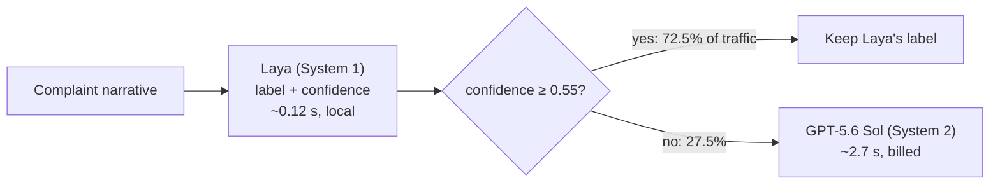

# fast-slow-cfpb

**Can a small local model handle the easy cases on its own and pass only the hard ones to a big, paid one?**

This project sorts CFPB consumer complaints into ten product categories with two systems:

- **System 1 (fast):** [Laya](https://huggingface.co/convaiinnovations/laya), a 421M-parameter local decision model. It labels a complaint in about 0.12 s and reports how sure it is.
- **System 2 (slow):** GPT-5.6 Sol through the OpenAI API. It is more accurate, takes about 2.7 s, and is billed per call.

A router keeps Laya's answer when Laya is confident and sends the complaint to Sol otherwise. The project also asks a broader question: **is Laya usable as a platform component**, something you point at a new problem and get a fast answer with an honest confidence? The full write-up, with interactive charts, is in [`docs/index.html`](docs/index.html).

## Headline result

Test set, 2,000 complaints, reweighted to the real complaint mix:

| | Accuracy | Sent to Sol |
|---|---:|---:|
| Laya alone (zero-shot, local) | 78.2% | 0% |
| **Laya → Sol router, threshold 0.55** | **88.1%** | **27.5%** |
| Sol alone | 89.4% | 100% |

The router keeps **98.5% of Sol's accuracy with 27.5% of the calls**. The threshold was picked on the validation set; the test set played no part in choosing it.

## How it works



Data preparation runs once:

1. **Download** the 21 zip files of the [CFPB Narratives Archive](https://www.consumerfinance.gov/foia-requests/foia-electronic-reading-room/cfpb-consumer-complaint-database-narratives-archive/), Dec 2011 to Aug 2026. The live database stopped publishing narratives on 14 Aug 2026, so this frozen archive is the only source.
2. **Filter** to the 3,851,415 complaints that have a written narrative. The zips are streamed in chunks, never unpacked to disk.
3. **Canonicalize** 21 raw product labels into 10 classes. CFPB renamed its product field in 2017 and 2023; merging the eras stops the label from leaking the filing date.
4. **Split** into 2,000 validation and 2,000 test complaints, 200 per class. The remaining 3.85M are held back as training data for the fine-tuning and TF-IDF experiments.

"Real mix" figures reweight the balanced 200-per-class sets to each class's share of all 3.85M narratives. Credit reporting alone is 65% of real traffic, so the real-mix and balanced numbers differ a lot.

## Results

### Fast systems compared (test set)

| Configuration | Real mix | Balanced | To Sol, real | Time per complaint |
|---|---:|---:|---:|---:|
| Laya alone | 78.2% | 48.0% | 0% | 0.12 s |
| Qwen3.5-4B alone (4-bit, MLX) | 83.5% | 66.1% | 0% | 0.78 s |
| TF-IDF + logistic regression alone | 90.6% | 71.5% | 0% | ~3 ms |
| Sol alone | 89.4% | 77.1% | 100% | ~2.7 s, billed |
| Laya → Sol, t = 0.55 | 88.1% | 73.3% | 27.5% | 0.12 s + Sol |
| Qwen → Sol, t = 0.84 | 88.2% | 73.9% | 15.6% | 0.78 s + Sol |
| TF-IDF → Sol, t = 0.61 | **92.4%** | 77.3% | 9.1% | ~3 ms + Sol |

- **Zero-shot, Laya is the weakest classifier** (48.0% balanced) but its confidence is a good routing signal: AUROC 0.74 for right vs. wrong answers, calibration error (ECE) 0.096, against 0.67 and 0.194 for Qwen.
- **Qwen3.5-4B starts higher**, so it needs Sol for fewer complaints, but it is 6× slower and more overconfident.
- **A supervised TF-IDF model beats every model here, Sol included,** once it can train on labelled complaints (up to 30,000 per class, about 6 minutes on a CPU).

### Fine-tuning Laya (test set, balanced accuracy)

Laya fine-tuned with its own trainer, against TF-IDF trained on exactly the same complaints:

| Labelled complaints per class | Laya, top 8 layers (Mac) | Laya, every layer (Colab T4) | TF-IDF, same data |
|---:|---:|---:|---:|
| 0 (zero-shot) | 48.0% | 48.0% | — |
| 10 | 58.2% | — | 46.2% |
| 50 | 59.3% | 68.5% | 60.6% |
| 500 | 60.2% | 72.7% (73.6% with Laya's default loss) | 73.2% |

With few labels Laya learns faster than TF-IDF; with many it keeps pace. On a 16 GB Mac only the top 8 of 28 layers fit in memory, and that is what caused the plateau near 60%: a full fine-tune on a free Colab T4 needed no workarounds and scored 9–13 points higher.

### Scorecard: Laya as a platform component

| Capability | Verdict |
|---|---|
| Confidence as a routing gate | Works |
| Confidence after fine-tuning (ECE 0.02–0.06) | Works |
| Reading the right confidence field | Limit, see below |
| Speed and footprint (0.12–0.14 s on a Mac, 0.04 s on a T4) | Works |
| Integration effort ([`system1.py`](src/models/system1.py) is 80 lines) | Works |
| Zero-shot accuracy on a new taxonomy | Weak |
| Learning from few and many labels | Works |
| Several questions at once (no loss on the first) | Works |
| Cost of each extra question (one full pass each) | Limit |
| Fine-tuning on Apple silicon | Limit |

Only one problem type, single-label text classification, has been tested so far.

### A pitfall worth knowing: `confidence` vs. `answer_confidence`

For a `choice` question, Laya returns two scores. The field named `confidence` is **normalized entropy**, which temperature scaling doesn't calibrate. The calibrated probability of the chosen label is **`answer_confidence`**. This project first routed on `confidence`, and fine-tuned Laya looked badly underconfident (test ECE up to 0.23). Read correctly, its calibration error is 0.02–0.06. [`system1.classify`](src/models/system1.py) returns `answer_confidence`, and [`tests/test_eval.py`](tests/test_eval.py) checks that the router reads it.

## Repository layout

```
src/
  data/        download.py, preprocess.py, taxonomy.py (21 labels -> 10), split.py
  models/      system1.py (Laya), system2.py (Sol), slm.py (local MLX models), tfidf.py
  router.py    the fast/slow router, on saved predictions or live
  eval.py      picks the threshold on validation, reports test in both class mixes
  experiments/ low-data fine-tuning curve, multi-question test, option budget
tests/         checks for the metrics, router, prompt caching and TF-IDF reweighting
colab/         laya_t4.ipynb: the full fine-tune on a free Colab T4
results/       saved metrics and threshold sweeps behind every figure (see results/README.md)
docs/          index.html: the full illustrated write-up
data/          not committed; rebuilt by the pipeline (see data/README.md)
```

## Running it

Requires Python 3.13 and [uv](https://docs.astral.sh/uv/). `slm.py` (Qwen) needs Apple silicon, because it runs on MLX.

```bash
uv sync
echo "OPENAI_API_KEY=sk-..." > .env    # only needed for Sol
```

If the project sits on a drive that can't store symlinks (exFAT, for example), keep the environment elsewhere and set this before every `uv` command:

```bash
export UV_PROJECT_ENVIRONMENT=~/.venvs/fast-slow-cfpb
```

### Rebuild the data

```bash
uv run python -m src.data.download     # 21 zips, ~1.4 GB, into data/raw/
uv run python -m src.data.preprocess   # data/processed/complaints_with_narrative.parquet
uv run python -m src.data.split        # train / val / test parquet files
```

### Run the systems and evaluate

```bash
uv run python -m src.models.system1                 # Laya on val + test
uv run python -m src.models.system2                 # Sol on val + test (paid; resumable)
uv run python -m src.models.slm qwen3.5-4b-4bit     # Qwen on val + test (optional)
uv run python -m src.models.tfidf                   # train TF-IDF, predict val + test (optional)

uv run python -m src.eval                           # Laya -> Sol: threshold, test metrics, full sweep
uv run python -m src.eval --fast tfidf              # TF-IDF -> Sol
uv run python -m src.eval --fast qwen3.5-4b-4bit    # Qwen -> Sol
```

### Route a complaint live

```bash
uv run python -m src.router "I disputed an account on my credit report and the bureau never responded..."
uv run python -m src.router --fast tfidf "..."
```

### Tests

```bash
for t in eval issue_types slm tfidf; do uv run python -m tests.test_$t; done
```

### Fine-tuning experiments

On a Mac (top 8 layers), one at a time:

```bash
uv run python -m src.experiments.lowdata 10 10 2    # N per class, epochs, grad accumulation
uv run python -m src.experiments.tfidf_curve        # TF-IDF on the same samples
```

On a free Colab T4 (every layer), open [`colab/laya_t4.ipynb`](colab/laya_t4.ipynb) and upload `laya_t4_bundle.zip`, which holds `val.parquet`, `test.parquet`, the training samples `data/processed/laya-ft-n50_train.jsonl` and `laya_ft_train_500.jsonl` (renamed `train_n50.jsonl` and `train_n500.jsonl`), and `questions.json` (`system1.QUESTIONS` as JSON).

## Caveats

- **One problem type.** Everything here is single-label classification on one dataset. Whether Laya generalizes across problem types needs a second, different use case.
- **Small classes.** The smaller classes rest on 200 complaints each in val and test, so treat the third digit of real-mix figures loosely.
- **"Debt or credit management" is hard for every model.** It overlaps credit reporting, and the zero-shot models get it right a third of the time or less.
- **No router with fine-tuned Laya in front yet.** The T4 predictions exist and are scored, but no threshold has been picked for them.
- **Sol figures come from saved answers.** Re-running Sol costs API credits; `system2.py` resumes and reuses any complaint already answered.

## Data and license

The code is released under the [MIT License](LICENSE). Complaint data comes from the [CFPB Consumer Complaint Database Narratives Archive](https://www.consumerfinance.gov/foia-requests/foia-electronic-reading-room/cfpb-consumer-complaint-database-narratives-archive/) (public domain). It is not redistributed here; the pipeline above rebuilds it. Model weights (Laya, Qwen) are downloaded from Hugging Face under their own licenses.
